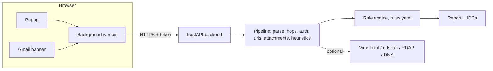

# Phishing Email Analyzer

A Chrome extension and Python backend that analyze a suspicious email and explain, in plain English, whether it is phishing, with a full technical breakdown and IOC export for analysts.

> **Demo:** add a screenshot or GIF at `docs/demo.gif` and embed it here with ``. Suggested capture: drop `backend/tests/fixtures/03_lookalike_punycode.eml` on the popup, then open the Technical details tabs.

## What it does

- **Verdict with reasons.** `SAFE`, `SUSPICIOUS` or `PHISHING`, a 0-100 score, and the top reasons in plain language. Every point traces to a named rule in a YAML file.
- **Two ways in.** Drag a `.eml` into the popup, or open an email in Gmail and get a red/yellow/green banner above it.
- **Authentication.** Reads the receiving provider's SPF/DKIM/DMARC results, re-verifies them live, computes DMARC alignment (relaxed and strict), and flags disagreements.
- **Routing.** Rebuilds the `Received` chain, spots impossible timestamps and fabricated hops, finds the connecting IP.
- **Links.** Extracts, unwraps (SafeLinks, Google, Proofpoint...), de-duplicates and defangs URLs; catches text-vs-target mismatches, IP hosts, `user@` tricks and shorteners.
- **Attachments.** Hashes, true file type from magic bytes, double extensions, executables, password-protected archives, Office macros with auto-run triggers. Nothing is executed.
- **Impersonation.** Display-name spoofing, Reply-To/Return-Path mismatches, punycode/homoglyph/typosquat domains, domains registered in the last 30 days.
- **Reputation (optional).** VirusTotal, urlscan.io (verdict, final URL, screenshot) and RDAP; works fully without any keys.
- **IOC export** as JSON or CSV, defanged.

## Architecture



The extension never holds third-party API keys; it only knows the URL and token of your backend. The backend parses the email in memory, runs the stages, scores the signals and returns a `Report`. Details and sequence diagrams: [docs/architecture.md](docs/architecture.md).

## How detection works

| Stage | What it checks | Docs |
|---|---|---|
| Parsing | Headers (RFC 2047), MIME tree, bodies, nested messages, malformed input | [parsing](backend/app/parsing/README.md) |
| Authentication | Delivery-time Authentication-Results, live SPF/DKIM/DMARC, alignment | [auth_checks](backend/app/auth_checks/README.md), [primer](docs/email-auth-primer.md) |
| Hop tracing | Received chain, trust boundary, forged-hop heuristics | [hops](backend/app/hops/README.md) |
| URLs | Extraction, unwrapping, defanging, mismatch | [urls](backend/app/urls/README.md) |
| Attachments | Hashes, magic bytes, macros | [attachments](backend/app/attachments/README.md) |
| Heuristics | Spoofing, lookalike domains, wording | [heuristics](backend/app/heuristics/README.md) |
| Enrichment | VirusTotal, urlscan.io, RDAP | [enrichment](backend/app/enrichment/README.md) |
| Scoring | Weighted rules, thresholds, hard overrides | [scoring](backend/app/scoring/README.md), [rules table](docs/scoring-rules.md) |

Hard overrides: a hash VirusTotal knows as malware forces `PHISHING`; DMARC failure combined with a brand lookalike domain also forces `PHISHING`.

## Sample result

Fixture `04_dmarc_alignment_fail.eml` (SPF passes for the sender's own domain while the visible From is someone else's), trimmed:

```json
{
  "verdict": "SUSPICIOUS",
  "score": 55,
  "reasons": [
    {"rule_id": "dmarc_fail", "weight": 40,
     "text": "The email claims to come from example.com, but example.com's own security policy says it was not authorised to send it (DMARC failed)."},
    {"rule_id": "spf_misaligned", "weight": 10,
     "text": "The email was sent on behalf of spammer-bulk.net, not example.com, which is the address you see. Scammers use this to look legitimate."}
  ],
  "auth": {
    "delivery": {"trusted": true, "results": [
      {"method": "spf", "result": "pass"}, {"method": "dkim", "result": "none"}, {"method": "dmarc", "result": "fail"}]},
    "spf_alignment": {"from_domain": "example.com", "authenticated_domain": "spammer-bulk.net", "relaxed": false, "strict": false}
  },
  "iocs": [{"type": "domain", "value": "spammer-bulk.net", "defanged": "spammer-bulk[.]net", "context": "Return-Path domain"}],
  "warnings": []
}
```

## Quick start

Prerequisites: Docker, Node 20+ (for the extension), Python 3.11+ (only to run tests outside Docker).

1. **Get API keys (optional).** VirusTotal: free account -> profile -> API key (about 4 requests/min, 500/day). urlscan.io: free account -> Settings & API. RDAP needs none. Skipping both still gives a full offline-minus-enrichment analysis.
2. **Configure.**
   ```
   cp .env.example .env
   python -c "import secrets; print(secrets.token_urlsafe(32))"   # put the output in API_TOKENS=
   ```
   Add `VT_API_KEY` / `URLSCAN_API_KEY` if you have them.
3. **Run the backend.**
   ```
   docker compose up --build
   curl http://127.0.0.1:8000/health      # {"status":"ok"}
   ```
4. **Build and load the extension.**
   ```
   cd extension && npm install && npm run build
   ```
   Chrome -> `chrome://extensions` -> Developer mode -> **Load unpacked** -> `extension/dist`. Open the extension's **Options**, enter `http://127.0.0.1:8000` and your token, press *Test connection*. Optional: set `CORS_ALLOWED_ORIGINS=chrome-extension://<extension id>` in `.env` for strict CORS.
5. **Try it.** Drop a file from `backend/tests/fixtures/` on the popup. In Gmail, open a message (see the caveat below).
6. **Run the tests.**
   ```
   cd backend && python -m venv .venv && .venv/Scripts/activate     # Linux/macOS: source .venv/bin/activate
   pip install -e ".[dev]" && python -m pytest -q                   # or: make test
   cd ../extension && npm test
   ```
   Tests need no network and no API keys.

## Privacy model

- Emails are processed **in memory**; bodies and attachments are never written to disk or logged.
- Stored: enrichment results keyed by hash (cache), and a short-lived in-memory report (15 minutes) for IOC export.
- Leaves your machine only when `enrich=true`: link URLs (VirusTotal lookup, urlscan.io scan), attachment hashes, domain names (RDAP/DNS).
- **File uploads never happen automatically.** Sending an attachment to VirusTotal needs an explicit confirmation per file.
- Full table: [docs/privacy.md](docs/privacy.md).

## Limitations and future work

- **Gmail integration is unverified against a live account.** The selectors and the "Show original" URL are isolated in `extension/src/content/gmail-selectors.ts` with a repair checklist. The popup path always works.
- **No sandbox detonation.** VirusTotal/urlscan give *reputation* (what others already know); a brand-new sample has none. Real detonation (running a file in an instrumented VM) is future work.
- **Outlook web** is out of scope for v1; it would use the Microsoft Graph API to fetch the message MIME.
- **Scoring** is hand-weighted rules, not ML; calibrate against real mail before trusting thresholds.
- **Firefox**: needs a manifest tweak and `browser.*` APIs.
- Live runs against VirusTotal/urlscan/RDAP were exercised via mocks of their documented responses; do one run with real keys.
- Auth is a shared token, not strong authentication (see [api README](backend/app/api/README.md)).

## Project structure

```
.
├── README.md  LICENSE  Makefile  docker-compose.yml  .env.example
├── docs/                 architecture, scoring rules, auth primer, privacy
├── backend/
│   ├── Dockerfile  pyproject.toml
│   ├── app/              api/ parsing/ auth_checks/ hops/ urls/ attachments/
│   │                     heuristics/ enrichment/ scoring/ cache/ models/
│   │                     pipeline.py services.py ioc.py netutil.py config.py main.py
│   └── tests/            unit + integration tests, fixtures/ (10 synthetic .eml)
└── extension/
    ├── manifest.json  vite.config.ts  popup.html  options.html
    └── src/              background/ content/ popup/ options/ shared/
```
Every code folder has its own README (purpose, concepts, walkthrough, decisions, limits, tests, references).

## Tech stack

Backend: Python 3.11+, FastAPI, Uvicorn, Pydantic v2, httpx, dkimpy, pyspf, dnspython, tldextract, idna, confusable-homoglyphs, python-magic (optional), oletools, SQLite, pytest, ruff. Extension: TypeScript, Vite, Manifest V3, vanilla DOM. Docker and docker compose.

## License

MIT. See [LICENSE](LICENSE).
