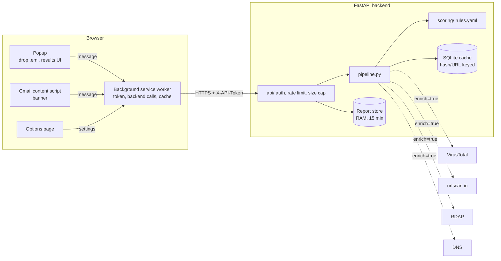
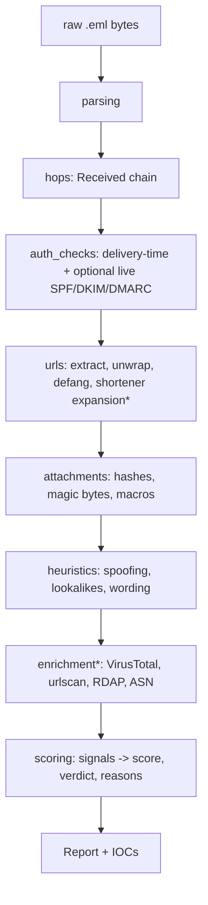
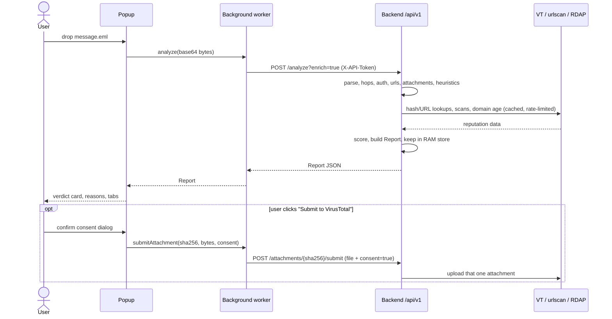
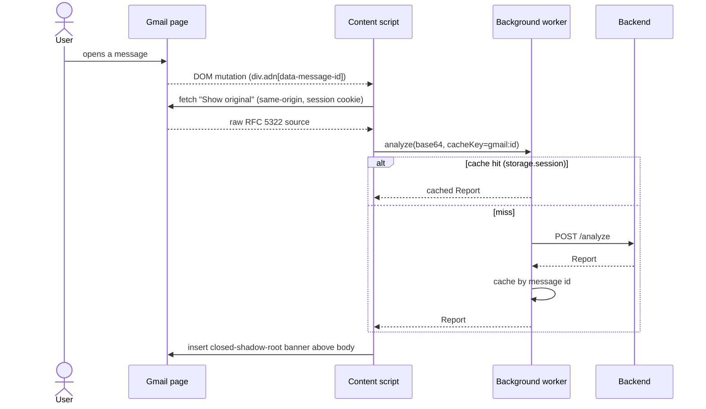

# Architecture

## Components

## Pipeline stages

`*` only when `enrich=true`. Each stage runs inside a guard: an exception becomes an entry in `Report.warnings` and the pipeline continues.

## Flow 1: popup upload

## Flow 2: Gmail auto-scan

## Data held where

| Data | Where | Lifetime |
|---|---|---|
| Raw email, attachments | request memory in the backend | the request |
| Report (no bodies/bytes) | backend RAM `ReportStore` | 15 min (configurable) |
| VT/urlscan/RDAP results | SQLite, keyed by hash | per-source TTL |
| Backend URL, token | `chrome.storage.local` | until removed |
| Report per Gmail message | `chrome.storage.session` | until browser closes |

## Failure model

- Missing API key -> source skipped, reported in `enrichment.sources`.
- DNS/HTTP error -> that item skipped or a stage warning; verdict still produced.
- Rate limit reached -> lookup skipped with an explanation (never blocks the request for long).
- `enrich=false` -> no outbound network of any kind.
